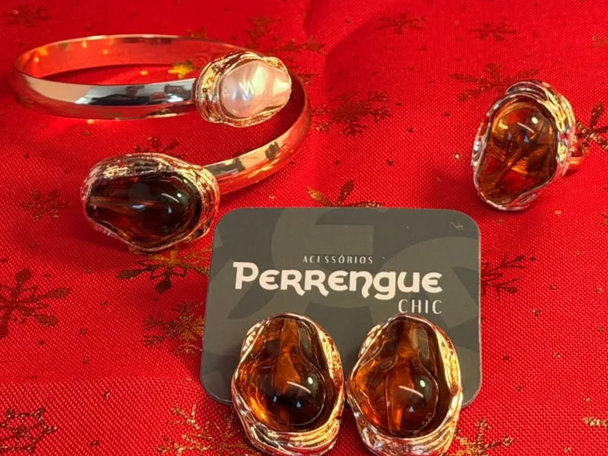

# Perrengue Chic: Catálogo Digital de Natal

Landing page/catálogo interativo da coleção de Natal da Perrengue Chic, feita em **HTML5 + CSS3 + JavaScript Vanilla**, sem backend, sem build e pronta para **GitHub Pages**.

## Prévia local

Abra um terminal na pasta do projeto e rode:

```bash
python3 -m http.server 8000
```

Depois acesse `http://localhost:8000`. Também é possível abrir `index.html` diretamente no navegador.

## Publicar no GitHub Pages

1. Envie os arquivos deste repositório para o branch que serve o GitHub Pages (geralmente `main`).
2. No GitHub: **Settings → Pages → Build and deployment**.
3. Selecione **Deploy from a branch**, escolha `main` / `/ (root)` e salve.
4. O site ficará disponível em `https://<seu-usuario>.github.io/<nome-do-repositorio>/`.

Todos os caminhos são relativos, então o projeto funciona tanto na raiz quanto em um subdiretório do Pages.

## Estrutura

```
index.html                  Conteúdo e estrutura semântica de todas as seções
css/style.css               Estilos mobile-first, cores, fontes e responsividade
js/main.js                  Barra de progresso, carrossel, menu, filtros e WhatsApp
assets/img/                 Logos, banner do hero, banners do carrossel e fotos dos conjuntos
fonts/                      Arquivos locais da fonte Dream Orphans (regular e itálico)
```

## Personalizando

### Produtos

Cada produto é um bloco em `index.html`:

```html
<article class="product-card" data-category="brincos" data-product="Nome da peça">
  ...
  
  <h3>Nome da peça</h3>
  <p class="product-card__desc">Par de brincos, anel e pulseira.</p>
  <p class="product-card__price">
    <span class="product-card__price-label">Valor</span>
    <span class="product-card__price-value"><small>R$</small> 59,90</span>
  </p>
  <a class="btn btn-gold btn--card whatsapp-link" data-product="Nome da peça" ...>
    Comprar pelo WhatsApp
  </a>
</article>
```

Os nove conjuntos usam as fotos reais enviadas, em `assets/img/conjunto-*.webp`, exatamente como foram recebidas (2880 × 2700), sem recorte ou redimensionamento. Os cards não exibem badge de categoria, já que o visitante escolhe a categoria pelo filtro. Para marcar uma peça como vendida, adicione a classe `product-card--unavailable` ao card, inclua `<span class="badge badge--unavailable">Indisponível</span>` no canto da foto e use `<button class="btn btn--unavailable btn--card" disabled>Indisponível</button>` no lugar do link do WhatsApp. O CSS coloca o card inteiro em tons de cinza.

Cada aba exibe até **seis peças por vez**. Se houver mais, os botões de página e as setas aparecem no fim do catálogo, acima dos botões de categoria. Para duplicar: copie o bloco, troque `data-category` (valores usados nos filtros: `brincos`, `colares`, `pulseiras`, `aneis`, `conjuntos`), `data-product`, o `src` da imagem, o nome, a descrição e o preço. O JavaScript monta automaticamente a URL do WhatsApp com o nome da peça. Se quiser adicionar uma categoria nova, crie um botão `.tab` com `data-filter` correspondente.

No momento, o catálogo tem **48 peças**: **Conjuntos** (9 peças), **Pulseiras** (8 peças) e **Anéis** (31 peças), com fotos reais em `assets/img/conjunto-*.webp`, `assets/img/pulseira-*.webp` e `assets/img/anel-*.webp`. Anéis que aparecem em dupla na foto custam R$ 14,90; os demais, R$ 9,90. Brincos e Colares exibem o aviso “Novidades em breve” no lugar de produtos ilustrativos: cada aviso é um bloco `.coming-soon` cujo `data-category` combina com a aba correspondente. Ao cadastrar uma peça de verdade, adicione o `.product-card` e remova o `.coming-soon` daquela categoria.

Para usar fotos reais, coloque o arquivo em `assets/img/` e troque apenas o `src` da `` (o mesmo valor serve para desktop e mobile).

### Banner do hero

A foto cobre toda a seção pelo elemento `` no início do hero. Substitua `assets/img/hero-natal.jpg` mantendo o nome do arquivo, ou troque esse `src`. O recorte é controlado por `object-position` e o overlay verde-oliva pela classe `.hero__overlay` em `css/style.css`.

### Banners do carrossel

Os três banners ficam em `assets/img/banner-collab.webp`, `banner-loja.webp` e `banner-natal.webp`. O bloco de marcação está logo abaixo do hero em `index.html`, com `.banners__viewport` (recorte) e `.banners__track` (trilha que desliza). Para adicionar outro, duplique um `<figure class="banner-slide">` e o `<button class="banner-dot">` correspondente. O loop automático (8 segundos, com um slide clone para transição contínua) fica em `js/main.js`.

### Seção final

A foto mesclada ao verde-oliva da seção “Vamos celebrar juntas?” está em `assets/img/cta-natal.jpg` e é aplicada em `.cta` no CSS.

### Logos

- `assets/img/logo-perrengue-chic-creme.webp`: versão creme, usada no cabeçalho verde e no rodapé.
- `assets/img/logo-perrengue-chic.webp`: versão laranja original, disponível para fundos claros.
- `assets/img/favicon.png` e `assets/img/favicon-apple-touch.png`: gerados a partir da arte `FAVICON-2.webp`, com fundo transparente.

### Cores

O CSS e os SVGs usam somente: `#FFF6ED`, `#FFEDDC`, `#727272`, `#3B432E`, `#2C3322`, `#C5A059` e `#B89246` (com transparências dessas mesmas cores). O logotipo fornecido mantém as cores próprias da arte original.

### Tipografia

- **Poppins** é carregada pelo Google Fonts para textos, filtros e preços.
- **Dream Orphans**: arquivos `fonts/Dream-Orphans.woff2` e `fonts/Dream-Orphans-Italic.woff2` já incluídos. A `@font-face` em `css/style.css` carrega a fonte localmente; apenas o peso regular é usado nos títulos.

### Links e dados da loja

Instagram, WhatsApp geral e textos operacionais (pagamentos, horários e entregas) estão diretamente em `index.html`. O número usado nos links é `558399240346` (+55 83 9924-0346); ao trocá-lo, atualize-o também na constante `WHATSAPP_NUMBER` em `js/main.js`.

## Grid de produtos

- Mobile: `grid-template-columns: 1fr`
- Tablet (≥ 768px): `grid-template-columns: repeat(2, 1fr)`
- Desktop (≥ 1024px): `grid-template-columns: repeat(3, 1fr)`

A moldura acompanha a proporção das fotos enviadas: `16 / 15` para os conjuntos (2880 × 2700) e `1440 / 1444` para pulseiras e anéis. Assim elas aparecem inteiras, sem recorte, sem distorção e sem faixas laterais.
